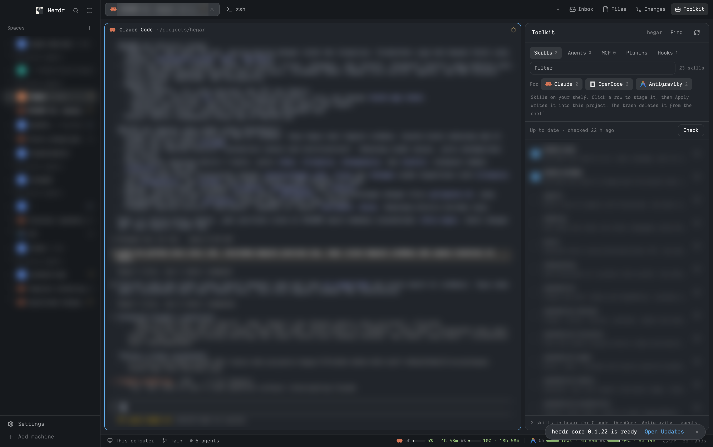

# Hégar · Herdr Layout

A clean, GPU-accelerated workspace layout for AI-driven development in [Herdr](https://herdr.dev).



## Highlights

- **Unified Left Sidebar**: Merges Spaces, Agents, and Sub-agents into a single collapsible tree hierarchy.
- **Custom Space Logos & Emojis**: Interactive 24-preset emoji picker per space.
- **Folder Browse & Create on `+`**: Built-in native macOS Cocoa folder picker with "New Folder" support.
- **Live AI Quota Widget**: Real-time quota tracking for **Google Antigravity** and **Claude Code** with exact native CLI colors and reset countdowns.
- **Interactive Human-in-the-Loop Inbox**: Dedicated right-hand panel card matching `Files` and `Changes`, featuring live agent question snippets and 1-click `✓ Approve (Yes)`, `✕ Reject (No)`, and custom text replies.
- **Animated Drag-and-Drop**: Smooth space reordering with elevation and drop indicators.

## Installation

To add this layout to your local Herdr setup:

1. Copy `layouts/hegar.json` into `~/.config/herdr-app/layouts/`
2. Copy the mods from `mods/` into `~/.config/herdr-app/mods/`:
   - `mods/hegar`
   - `mods/inbox`
   - `mods/tabs`
   - `mods/ai-usage`
3. Switch to Hégar in Herdr Settings or run:
   ```bash
   herdr-app switch hegar
   ```

## Recipe

See [RECIPE.md](RECIPE.md) for the complete design brief and technical specification.
