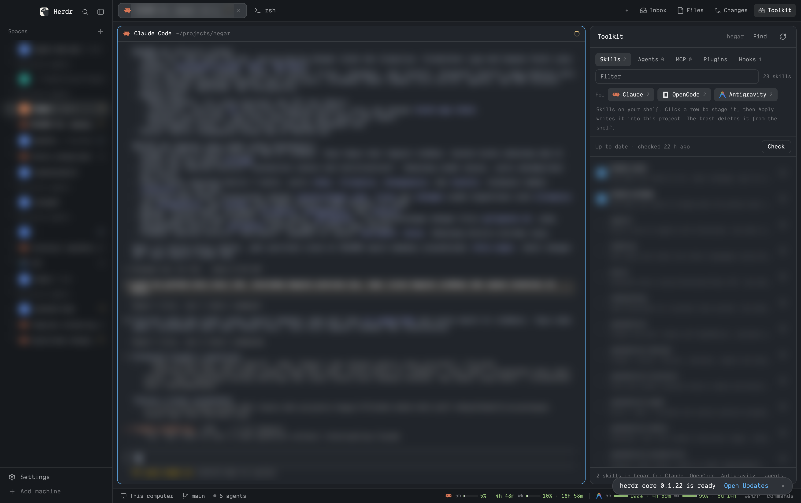

# Hégar

A clean, GPU-accelerated workspace layout for AI-driven development in Herdr, featuring a unified left sidebar that brings together spaces, agents, and sub-agents into a single tree hierarchy with native folder browsing on space creation, real-time agent-aware AI quota bars (with exact TUI colors for Antigravity and Claude Code), an interactive Human-in-the-Loop Inbox card panel next to Files and Changes for one-click approvals and question replies, and drag-and-drop space reordering.

## What you see

The window is divided into a dedicated left workspace sidebar and a flexible center work area with an optional right panel stack:

1. **Left Sidebar (`sidebar`, width 280px, resizable 180–520px, chrome background):**
   - **Top Brand Block (`brand`, height 46px):** Window drag handle, macOS traffic lights padding (76px), Herdr icon and title, command palette search button, and sidebar collapse toggle.
   - **Unified Workspace (`hegar-main`, flex 1):**
     - **Spaces Header:** Displays clean `Spaces` label with space count badge `(N)` on the left, and a `+` button on the right that opens a small menu: **Browse folder…** or **New terminal in home**.
     - **Space Cards:** Card header with folder fold/unfold chevron, colored initial-letter avatar (as in the default list), active space indicator (`selected` background, no border), space title, git branch indicator, and status badge (`!` red indicator for blocked, spinning blue icon for working, agent count badge).
     - **Nested Agents:** Indented rows (22px) displaying program icon (Antigravity, Claude Code, OpenCode), live title, and status badge (`Needs you`, `Working`, `Done`, `Idle`).
     - **Sub-agents:** Indented rows (28px) connected via ASCII tree markers (`├─`, `└─`, `│`), live title, and status badge.
     - **Live AI Quota Widget:** Located directly above the footer divider, displaying agent selector chips (`[Auto] [Antigravity] [Claude]`), a refresh spinner, and exact live quota bars matching native CLI screens:
       - *Antigravity Mode:* Displays Account email in cyan (`#5fa8eb`), Gemini Models (Gemini 3.8 Flash) with Weekly Limit Remaining (`77.7%`, mint green `#7cdba0`, dark track `#222d3b`) and Five Hour Limit Remaining (`91.1%`, mint green `#7cdba0`), countdown timers (`Refreshes in 119h 5m`, `Refreshes in 3h 30m`), and Claude/GPT Models with 100% available bars.
       - *Claude Code Mode:* Displays Current session (`0% used`, lavender `#8b8fe8`, dark track `#25263a`), Current week all models (`86% used`, lavender `#8b8fe8`, reset time `Nov 19 at 1pm`), and top MCP servers breakdown (`figcraft 49%`, `claude-in-chrome 7%`).
   - **Footer Block (`sidebar-footer`, height 69px):** Settings button (with app update indicator dot) and Add Machine button.

2. **Work Area (`work`, flex 1):**
   - **Tab Bar (`tabs`, height 42px, chrome background):**
     - Sidebar restore button (visible only when sidebar is hidden).
     - Horizontally scrollable agent tabs with active highlight, program icons, status indicators, double-click rename, close button.
     - `+` New Tab button.
     - Right-side Panel Buttons: `[Inbox (N)]` `[Files]` `[Changes]` with active toggle highlight and pending notification counter badge.
   - **Work Body (`work-body`, row, padding 8px, gap 8px):**
     - **Main Terminal (`main`, flex 1):** Active pane terminal block with 10px rounded corners, canvas background, pane header (split right, split down, zoom, close), and the default per-pane focus look: every pane frame has a neutral 1px border, and the pane that has the keyboard gets the accent colour all round. (A gradient focus colour was tried: the frame border is one flat colour and a mod cannot draw outside its block, so a gradient meant one ring around the whole pane area, which also coloured every terminal of a split tab. Reverted.)
     - **Right Panel (`panel`, width 368px, resizable 280–900px, hidden by default):**
       - Stack (`panel-body`) housing `inbox`, `files`, and `changes`.
       - All three panels share the identical outer card frame: `rounded(10).overflow_hidden().bg(t.background).border_1().border_color(t.border).text_color(t.foreground).text_size(13)` and height 42px header.
       - **Inbox Panel (`inbox`):**
         - Header with Inbox icon, count badge of blocked agents, refresh button.
         - Filter bar: `[Needs you]` `[Working]` `[Done]` `[Idle]` `[All]`.
         - Agent cards with live terminal output / question explanation box (`hc read`), quick 1-click `✓ Approve (Yes)`, `✕ Reject (No)`, interactive inline reply text input with `Send ↵` button, and `Open Terminal →` focus button.
   - **Status Bar (`status`, height 28px):** Displays workspace connection status and notifications.

## How it behaves

- **Agent Status Lifecycle:**
  - `blocked` (Needs you): Displayed with red theme color (`#ef4444`), bold "Needs you" badge in sidebar and tab bar, red notification pill counter on the `Inbox` button in the tab bar and header. In Inbox, presents the exact output question snippet and provides 1-click `✓ Approve (Yes)` (sends `y\n`), `✕ Reject (No)` (sends `n\n`), and direct text input with `Send ↵`.
  - `working`: Displayed with blue theme color (`#3b82f6`), rotating 900ms spinner icon, "Working" badge. In Inbox, shows active processing indicator and `Stop` button (`hc interrupt`).
  - `done`: Displayed with green theme color (`#22c55e`), "Done" badge. In Inbox, shows completion confirmation.
  - `idle`: Displayed with muted gray border dot. In Inbox, provides prompt dispatch box.

- **Interactions & Clicks:**
  - Clicking a space selects it (`space.select`), switching the visible tabs and active terminal.
  - Clicking the chevron folds/unfolds space agents or agent sub-trees.
  - Right-clicking a space opens the space context menu (Rename, Worktree, Close).
  - Left-clicking `+` in the Spaces header opens a popup (`spacemenu`): **Browse folder…** opens the system's folder picker (`pickFolder`) and makes a space in the folder chosen (the popup stays up, saying "Choosing a folder…", until the picker closes; cancelling makes nothing); **New terminal in home** makes a space with a terminal in the home folder at once (`space.new {folder: home, machine: ""}`: with no folder it would start in the folder of the space that is shown and repeat its name). Right-clicking `+` does the second directly. Neither gives the space a name: Herdr names it after where its first terminal is (its repo, else its folder, `~` at home) and the name follows the terminal, so a space started at home is `~` until you `cd` into a project, then takes the project's name, and goes back to `~` if you `cd` home.
  - Dragging a space initiates animated reordering with `shadow_2xl`, elevated card styling, and blue insertion indicator line. Dropping triggers `space.move`.
  - Clicking an agent or sub-agent focuses its pane (`pane.focus`) or summons it (`terminal.summon`).
  - Clicking `[Inbox]`, `[Files]`, or `[Changes]` in the tab bar toggles the right panel stack; clicking an active button closes the panel.
  - Clicking `sidebar-toggle` (or pressing `Cmd+B`) hides the sidebar cleanly; when hidden, an unhide button appears in the tab bar.
  - In AI Quota widget, clicking `[Auto]`, `[Antigravity]`, or `[Claude]` switches the live meter; clicking the refresh spinner re-runs the CLI background checks.

## Built from

- **Layout Structure (`layouts/hegar.json`):**
  - Root: row divider, background `canvas`, traffic lights `[12, 16]`.
  - Left: `sidebar` column (blocks: `brand`, `hegar-main`, `sidebar-footer`).
  - Center/Right: `work` column (blocks: `tabs`, `work-body` row containing `main` pane and `panel` stack, `status`).

- **Shipped Mods Used:**
  - `workspace-chrome`, `files`, `changes`, `menu`, `picker`, `new-menu`.

- **Custom Mods Included:**
  - `mods/sidebar/`: Unified Spaces, Agents, and Sub-agents sidebar with live dual-agent AI quota.
  - `mods/spacemenu/`: The popup the sidebar's `+` opens: browse for a folder, or a terminal in home at once.
  - `mods/inbox/`: Human-in-the-loop inbox, grouped by project (space) with a foldable header: avatar, name, agent count and a badge per state, the project with the most urgent agent first. Badges are tinted, bordered and carry a dot so even Idle reads. Per agent: its last reply (Claude Code and Antigravity session logs), or, when it waits on you, the real question read from its screen with its numbered choices as buttons (Approve / Reject for a y/n question), a custom answer box, Stop, and Open Terminal. Refreshes only for an agent whose status changed, and follows a question every 3 s while one is open.
  - `mods/tabbar/`: Tab bar customized with unhide restore button and tri-panel toggles (`inbox`, `files`, `changes`).
  - `mods/paneheader/`: Pane header with status, and split / zoom / close buttons on hover.
  - `mods/statusbar/`: Bottom status bar with the AI quota widget (opens `aiusage`). It is the only place the `claude` and `agy` CLIs are read (each read costs about 4 s and 1.7 s of CPU): every 3 minutes while the window is shown, 10 s after an agent finishes a turn, and when Refresh is pressed.
  - `mods/aiusage/`: Floating dashboard for the full AI quota breakdown. It draws what the status bar publishes (shared `ai.usage`), starts no program itself, and is sized to its content so it does not scroll.

- **Herdr APIs & Commands:**
  - State & Info: `spaces()`, `agents()`, `terminals()`, `panes()`, `focused()`, `theme()`, `shared()`, `setShared()`, `layout()`, `window()`, `settings()`.
  - Control Commands: `space.new`, `space.select`, `space.move`, `space.close`, `space.rename`, `pane.focus`, `terminal.summon`, `tab.select`, `tab.new`, `tab.close`, `tab.rename`, `tab.move`, `layout.toggle`, `layout.show`, `layout.hide`, `layout.select`, `layout.switch`.
  - System Execution: `exec()`, `hc()`, `pickFolder()`, `openOverlay()`, `closeOverlay()`.

- **Programs the mods run, and files they read outside their own folder** (Herdr asks that a layout says so):
  - `statusbar`: `nice -n 10 agy -p "/quota" --output-format json` and `nice -n 10 claude -p "/usage" --output-format json --no-session-persistence --setting-sources project` (run in `/tmp`: no session is saved, and the person's own hooks and settings are not loaded), the only place these run (each read is about 4 s and 1.4 s of CPU, and uses no model tokens: every 3 minutes while the window is shown, 10 s after an agent finishes a turn but at most once a minute, and on the popup's Refresh). The result is published as shared `ai.usage`; `aiusage` only draws it.
  - `inbox`: `hc read <address>` (only for an agent that waits on you, to read its question), `hc keys <address> <number|y|n> enter` (answering a choice), `hc send`, `hc interrupt`; and `sh -c "tail … | grep …"` over an agent's session log for its last reply. It reads `~/.claude/sessions/<pid>.json`, `~/.claude/projects/**/<session>.jsonl`, `~/.gemini/antigravity-cli/cache/last_conversations.json` and the Antigravity transcript, and `~/.claude/settings.json` (`aiusage`, for the model names).
  - `spacemenu`: none; it uses Herdr's own folder picker (`pickFolder`) and `space.new`.
  - `filesplus`: `sh -c` to copy a picture (max 25 MB) into `~/.config/herdr-app/data/filesplus/` so `image()` can draw it; the previous preview is removed first. Local folders only.
  - `changesplus`: `git diff`, `git log -8` (read only, no index writes) and `readTextFile` of new files, then `fetch` POST to `https://generativelanguage.googleapis.com/v1beta/models/<model>:generateContent` with the saved Gemini API key (`x-goog-api-key`), only when ✦ is pressed. The diff (at most 30,000 characters) leaves the machine. Key and model are in `localStorage`.
  - `toolkit`: its own shelf, `~/.config/herdr-app/toolkit/` (`skills/<name>/SKILL.md`, `mcp.json` as `{ "mcps": { name: def } }`, a server being `{ command, args | type: "remote", url, headers, env, cwd, description, source }`). Reads description lines through `list-skills.sh` in its own folder, `mcp.json`, and per project `.opencode/skills`, `.mcp.json`, `.opencode/opencode.json`. A click only stages a change; **Apply** runs `sh skill.sh enable|disable <root> <skills> <name>` (symlinks `.opencode/skills/<name>` to the shelf, and `.agents/skills` and `.claude/skills` to `.opencode/skills`; it removes only a link) and `sh -c` to write or remove `.mcp.json`, `.opencode/opencode.json`, `.agents/plugins/workspace-mcp/{plugin,mcp_config}.json` (`mcpFiles()`). `${VAR}` values stay as placeholders: Claude Code expands them, OpenCode gets `{env:VAR}`. It never edits `.gitignore`: add `.opencode/`, `.agents/`, `.claude/` and `.mcp.json` there yourself if a project should not commit them. Local folders only; the project root is the nearest folder up from the pane that has `.git`, `.opencode`, `.agents` or a package manifest, and HOME or `/` are refused.
  - `toolkit` delete: the trash icon on a shelf row asks first (a bar says what will be erased and in which projects it is turned off) and acts only on **Delete**. `projects.json` on the shelf records which projects have shelf items on (kept current whenever Toolkit refreshes a project); a delete turns the item off in those projects first (`skill.sh disable`, or `mcpFiles()` without the server), then removes it from the shelf (`remove-skill.sh <shelf>/skills <name>`, which only removes a real folder directly inside a path ending `/toolkit/skills`, or the `mcp.json` entry). If any project step fails nothing is removed from the shelf. Projects Toolkit has never seen keep their links; a link into the shelf whose skill is gone shows as a row of its own that can only be turned off. `skill.sh` only ever creates or removes links into the shelf (a real folder or any other link with the same name makes it refuse), and when the last skill is turned off it removes the empty `.opencode/skills`, the alias links and any now-empty `.opencode`, `.agents`, `.claude`. `list-active.sh` lists the project's links into the shelf. The shelf folder is watched (`watchFolder`), so items put there by hand appear without refreshing.
  - `toolkit` Find (network, only when Search or Add is pressed): `fetch` GET `https://skills.sh/api/search` and `https://registry.modelcontextprotocol.io/v0/servers`; Add of a skill runs `sh add-skill.sh <owner/repo> <skill> <shelf>`, which downloads `https://codeload.github.com/<owner>/<repo>/tar.gz/HEAD` with `curl` into a temp folder, copies the one skill folder to the shelf and removes the temp folder (only plain `owner/repo` and plain names are accepted). Add of an MCP server writes its entry into `mcp.json` (remote streamable-http, or an npm/pypi package run with `npx -y` / `uvx`; Docker images and bundles are marked not supported). A shelf item runs code on the person's machine once it is turned on and an agent starts: read it before turning it on.
  - No other mod uses the network itself; `claude` and `agy` do.

## Watch out

- **The Toolkit tab is not one of Herdr's panels:** `tabbar` appends `toolkit` to the saved `workspace.panels` list (which never names it), and `layouts/hegar.json` has the `toolkit` block in `panel-body`.
- **Do not edit Herdr's shipped mods** (`tabs`, `pane`, `workspace-status`, `spaces`, ...): on the next start Herdr moves an edited one to `<name>-edited` and restores its own. The mods here have plain names of their own (`sidebar`, `spacemenu`, `tabbar`, `paneheader`, `statusbar`, `inbox`, `aiusage`, `filesplus`, `changesplus`, `toolkit`), none of them a shipped name, and no hyphens.
- **The pane's focus colour is one flat colour** (`focus` in the pane frame). A gradient was tried twice and dropped: a ring node around the pane area coloured every terminal of a split tab at once; a gradient frame background shows through a transparent focus border but is computed over a larger area than the pane (barely visible) and its square-cornered content nicks the corners.
- **Frame borders, not mods, draw a pane's edge.** A mod draws only inside its own block, so a pane's header cannot colour its edge.
- **`init()` runs for real during `herdr-app check`.** `statusbar`, `aiusage` and `inbox` return early on `checking()` so a check starts no timer and runs no program.
- **Never poll Herdr's live data.** Herdr redraws a mod whenever spaces, agents, terminals, focus, theme or shared state change, so a mod notices a change in `render()` (`statusbar` sees an agent stop working or the popup's Refresh there; `inbox` sees which agent moved on there). The few timers only act on time: a read that is due, an open question to follow, countdowns by the minute.
- **Animate with the native `.spin()`, never a timer that calls `cx.notify()`:** every redraw redraws the whole window.
- **Colours come from `theme()`.** Limits are the theme's own green, yellow and red (`ansi2`, `ansi3`, `ansi1`), not `done` / `working` (status colours, blue in some themes). Only the space avatars keep their fixed palette, as in the default list.
- **Async work goes in `cx.spawn(async (cx) => …)`**, never a callback's `cx` used after an `await`.
- **Agent order:** `sidebar` calls `setAgentOrder` so `agent.next` / `agent.prev` follow the list as drawn. A sub-agent row opens with `terminal.peek`.
- **Agents on another machine** (address `machine/tN`): the Inbox cannot read their session log from here, so it shows their screen.
- **Inbox choices:** a numbered choice is answered by sending its number and Enter, read from the agent's screen with a parser tested on written sample dialogs, not on a live permission prompt. A y/n question is answered with `y` or `n` and Enter.
- Quota bars show nothing until the first read finishes (a few seconds after start); the last numbers are kept across restarts.
- The popup is sized by its content (350 px + 130 px per Antigravity group) and scrolls only if the window is shorter than that.

## Done when

- `herdr-app check` passes for each mod in `mods/` and `herdr-app status` lists no error.
- The sidebar groups agents under their space; dragging a space dims it and shows a 2 px line where it lands; no row is left dimmed after a click on its chevron.
- Splitting a tab shows each pane as a rounded card with a neutral 1 px border, and the focused pane has the accent colour all round.
- The status bar shows both quotas with live countdowns; clicking it opens the popup at once, with every group visible and no scrolling.
- The Inbox lists agents grouped by project with a visible badge per state, each agent's last reply, and for an agent that waits on you its question with buttons for the choices.
- With the window idle, no `claude` or `agy` process starts between the 3-minute reads.
